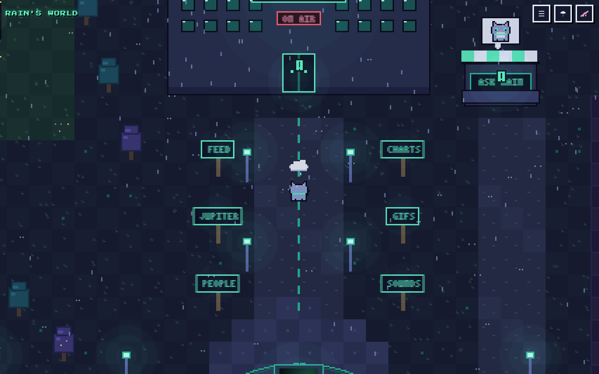
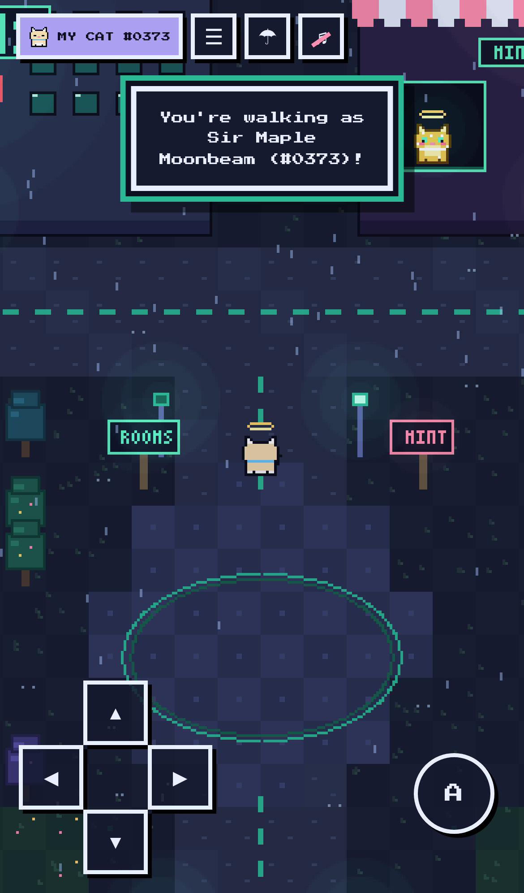
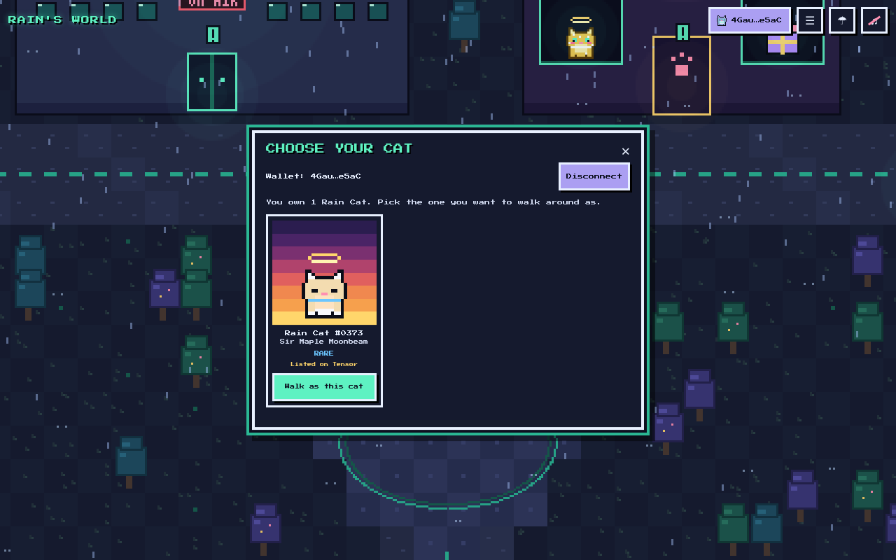

# Rain's World

A small pixel-art world for Rain, the cat assistant, with a landmark for everything Christian and Rain have built together. Walk up to a building and a pixel card pops up with what it is and a link.

**Play:** https://rain-world-beta.vercel.app



| Phone | Choose your cat |
| --- | --- |
|  |  |

## The buildings

Two buildings on the front walk, a few steps from where you start (and from the plaza signposts):

- **Rooms HQ** (left): Clubhouse-style live audio with Phantom Solana sign-in. The card links to [intherooms.xyz](https://www.intherooms.xyz). Made by Urua Labs.
- **Rain Cats Mint** (right): opens the mint panel (blind mint, 0.04 SOL), **My Rain Cats**, and **Walk as my cat**. Rooms members with a check mark see **Verified ✓? Claim your free cat at intherooms.xyz/mint**.

**Dev Row**, the street just south of the plaza (follow the GITHUB LABS / DEV SOUND signposts):

- **GitHub** (`@samsagewize`): opens [github.com/samsagewize](https://github.com/samsagewize).
- **Urua Labs**: opens [urualabs.com](https://urualabs.com).
- **Dev Building, message me**: opens [x.com/SamSageWize](https://x.com/SamSageWize) on X.
- **soundwav.fun**: opens [soundwav.fun](https://soundwav.fun).

Walk up to a door and its card pops up; the button (or a second E / A press at the door) opens the link in a new tab.

The rest is scenery: the plaza, trees, lamps and the two meadows where Rain Cats roam.

## Connect your wallet and walk as your cat

Tap **CONNECT WALLET** (top right) or press **C**. Phantom works as the desktop extension and inside the Phantom app's browser; in iPhone Safari the button reads **OPEN IN PHANTOM** and opens this page in the Phantom app (`https://phantom.app/ul/browse/...`).

- The picker lists the Rain Cats the wallet owns (image, name, nickname, rarity, plus cats you have listed on Tensor). **Walk as this cat** makes it the player, drawn from its DNA (Super Rares included). **Be Rain again** switches back.
- Read-only: the world only reads your public address. It never asks you to sign anything.
- Owned cats come from Rooms: `GET https://www.intherooms.xyz/api/raincats/owned?wallet=<address>` returns `{ wallet, verified, cats: [{ asset, number, name, nickname, rarity, image, dna, traits, listed }] }` (CORS for this site, cached 20 s, rate limited). Set by `rooms` in `raincats/config.js`.
- The choice is saved per wallet in localStorage (`rainworld.cat.<wallet>`). On every visit the world re-checks that the wallet still owns that cat; if not, you are Rain again.
- No cats yet? The picker shows a **Go to the Mint building** button.
- Old `?cat=<code>` links still work: you visit as that cat for the session only.

## Controls

- **Desktop:** arrow keys or WASD to walk, E / Enter / Space to open the nearest card, Esc to close, C to choose your cat, M for the Places list, R to toggle rain, N to toggle music.
- **Phone:** on-screen D-pad, or tap anywhere (or on a landmark) to walk there. The A button opens the nearest card.
- Top-right buttons: Places (fast travel), rain on/off, music on/off. Music is muted until you turn it on.

## Run it

It is plain HTML, CSS and JavaScript with no build step and no backend.

```bash
python3 -m http.server 8000
# open http://localhost:8000
```

## Credits

Made by Rain for Christian / Urua Labs.

Font: [Press Start 2P](https://fonts.google.com/specimen/Press+Start+2P) by CodeMan38, SIL Open Font License 1.1. All other art is drawn in code.

## Rain Cats (Solana NFT mint)

The Rain Cats Mint building sells **Rain Cats**, a 1,000-cat Metaplex Core collection (symbol RCAT, 5% royalties). It is a blind mint for 0.04 SOL; the cat is revealed after you pay. Holders can walk as their cats or let them roam the meadows.

**Live on Solana mainnet** (2026-11-04): collection `NoKDyLnGYSHjfSSAwQkfxsBLzk94NXgNqEXoSg84Bvi`, Candy Machine `DM8HhCKYCXESv1UHB5W31mSr9MF9WncL3gd6DMbAgwtJ`, Candy Guard `9oZ6UaRjaVmi75wQQVsVFmG1xkcR2nEN7v8iCsh8LH7x`. Guard groups: `public` (0.04 SOL to the creator wallet) and `free` (allowList of the creator wallet + mintLimit 1, so exactly one free mint). Full record: `tools/nft/MAINNET_LAUNCH.md`.

- `raincats/config.js`: the cluster, RPC, Candy Machine, guard, collection, treasury and free-mint wallets. While the addresses are `null` the panel shows "Mint opens soon".
- `raincats/mint.js`: the bundled mint and "My Rain Cats" UI. It is loaded only when the panel is opened. Source: `tools/nft/web/mint-src.js`. Build: `npx esbuild web/mint-src.js --bundle --minify --format=iife --define:global=globalThis --outfile=../../raincats/mint.js`.
- `tools/nft/`: the generator (`generate.js`), the Irys upload (`upload.js`), the Core Candy Machine deploy (`deploy.js`), and the mint tests (`minttest.js`, `mint-e2e.js`). Keypairs live outside the repo and are never committed.
- Rarity report: `docs/raincats-rarity.md`.
- Deep links: `?mint` takes you to the Mint building and opens the mint panel; `?mint=mine` opens My Rain Cats.
- Tests: `tools/e2e/worldcats.js` (Playwright, mocked watch-only Phantom that refuses to sign; `LIVE=1` uses the real Rooms API).
