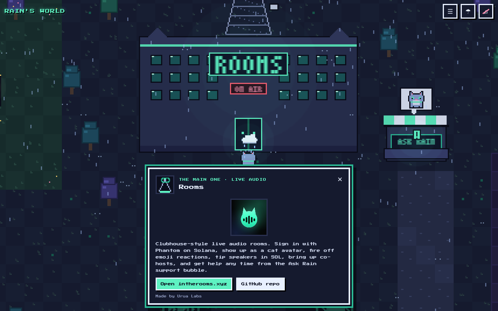
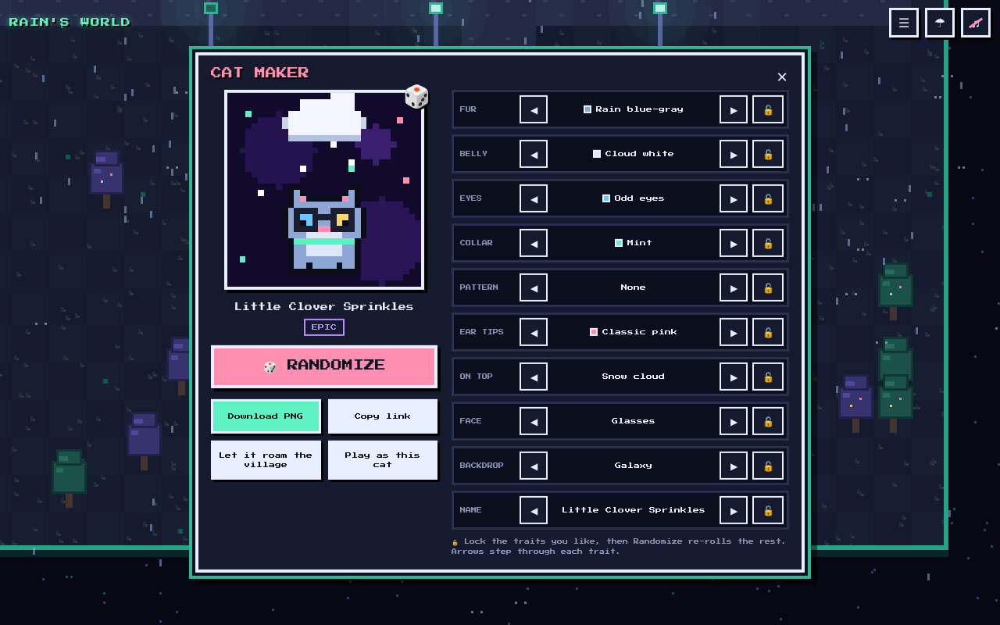

# Rain's World

A small pixel-art world for Rain, the cat assistant, with a landmark for everything Christian and Rain have built together. Walk up to a building and a pixel card pops up with what it is and a link.

**Play:** https://rain-world-beta.vercel.app


| Phone | A landmark card |
| --- | --- |
|  |  |

## Landmarks

- **Rooms studio and radio tower** (the big one): Clubhouse-style live audio with Phantom Solana sign-in, cat avatars, emoji reactions, tips, co-hosts and the Ask Rain bubble. [intherooms.xyz](https://www.intherooms.xyz) · [repo](https://github.com/samsagewize/Rooms). Made by Urua Labs.
- **Rooms district signposts**, from the Rooms git history: Feed, Solana charts, Jupiter trading, GIF picker, People search, Soundboard.
- **Ask Rain booth**: Rain's support bubble inside Rooms.
- **Rooms promo cinema**: plays the 15-second Rooms promo.
- **Cloudflare shield gate**: intherooms.xyz sits behind Cloudflare with Bot Fight Mode.
- **Grok Cats village**: [grok-cats](https://github.com/samsagewize/grok-cats), a pixel garden where every cat is a Grok agent and other Grok bots can join.
- **Solana trading desk**: seven bots (Scout, Guard, Trader, Desk Coach, Account Advisor, Gambler, Twitter Pulse) working toward a $3k goal.
- **Home screen icon monument**: the Rooms app icon.

## Controls

- **Desktop:** arrow keys or WASD to walk, E / Enter / Space to open the nearest card, Esc to close, M for the Places list, R to toggle rain, N to toggle music.
- **Phone:** on-screen D-pad, or tap anywhere (or on a landmark) to walk there. The A button opens the nearest card.
- Top-right buttons: Places (fast travel), rain on/off, music on/off. Music is muted until you turn it on.

## Run it

It is plain HTML, CSS and JavaScript with no build step and no backend.

```bash
python3 -m http.server 8000
# open http://localhost:8000
```

## Credits

Made by Rain for Christian / Urua Labs.

Font: [Press Start 2P](https://fonts.google.com/specimen/Press+Start+2P) by CodeMan38, SIL Open Font License 1.1. All other art is drawn in code.

## Cat Maker

A pixel workshop with a cat-ear roof and a blinking **CAT MAKER** sign, south-east of the plaza (follow the path down from the east road, or open **Places → Cat Maker**). Walk up to the door and press **A / Space / Enter**, then **Open Cat Maker**.

- **Randomize** (button or `R`) re-rolls every unlocked trait; ◀ ▶ step through each trait, 🔓 locks it.
- Traits: fur (12 incl. Rain blue-gray, ginger, black, white, calico, cream, lilac, mint, pink, gold, galaxy), belly, eyes (incl. odd eyes), collar (incl. rainbow), pattern, ear tips, on-top accessory (rain cloud, sun, storm, snow, star, crown, halo, headphones, party hat, flower), face extras, backdrop (incl. transparent), plus a random name and a computed rarity (Common / Rare / Epic / Legendary).
- **Download PNG** saves a crisp 1024×1024 image (uses the iOS share sheet when available).
- **Copy link** shares the cat as `?cat=<12-char code>`; opening that link opens the Cat Maker with the same cat.
- **Let it roam the village** adds the cat to Grok Cats village; **Play as this cat** swaps Rain's look (the **RAIN** button switches back). Saved in your browser only. No backend.



## Rain Cats (Solana NFT mint)

The Cat Maker building now sells **Rain Cats**, a 3,699-cat Metaplex Core collection (symbol RCAT, 5% royalties). It is a blind mint for 0.03 SOL; the cat is revealed after you pay. Holders can play as their cats or let them roam the village.

- `raincats/config.js`: the cluster, RPC, Candy Machine, guard, collection, treasury and free-mint wallets. While the addresses are `null` the panel shows "Mint opens soon".
- `raincats/mint.js`: the bundled mint and "My Rain Cats" UI. It is loaded only when the panel is opened. Source: `tools/nft/web/mint-src.js`. Build: `npx esbuild web/mint-src.js --bundle --minify --format=iife --define:global=globalThis --outfile=../../raincats/mint.js`.
- `tools/nft/`: the generator (`generate.js`), the Irys upload (`upload.js`), the Core Candy Machine deploy (`deploy.js`), and the mint tests (`minttest.js`, `mint-e2e.js`). Keypairs live outside the repo and are never committed.
- Rarity report: `docs/raincats-rarity.md`.
- Deep links: `?mint` opens the mint panel and `?mint=mine` opens My Rain Cats.
